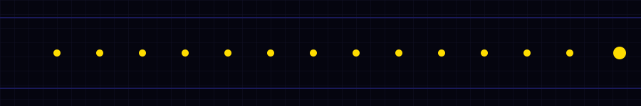

---

### 🛠️ Languages & Technologies

-  &nbsp; **C++**
-  &nbsp; **Java**
-  &nbsp; **Python**
-  &nbsp; **C#**
-  &nbsp; **JavaScript**
-  &nbsp; **Lua**
-  &nbsp; **HTML5**
-  &nbsp; **CSS3**

---

### 🤖 Interests

- 🤖 &nbsp; **Robotics Programming**
- 🖥️ &nbsp; **Desktop Applications**
- 🌐 &nbsp; **Web Applications**
- ⚙️ &nbsp; **Automation Scripts**
- 🛠️ &nbsp; **Utility Tools**

---

### 🚀 Projects

<table>
<tr>
<td width="50%" valign="top">

<h4>🌤️ fthsky</h4>

An AI-powered weather application built with Vanilla JavaScript, capable of searching cities, districts, neighborhoods, and villages across Türkiye.

- 🔍 Photon geocoding
- ⏰ Hourly + 7-day forecast
- 💬 Local AI assistant
- 📍 Location support
- 📱 PWA compatible

**Stack:** JavaScript · HTML5 · CSS3 · Open-Meteo API

</td>
<td width="50%" valign="top">

<h4>🚧 Coming Soon</h4>

New projects are in development. <a href="https://github.com/fth25?tab=followers">Follow along</a> to stay updated.

</td>
</tr>
</table>

---

